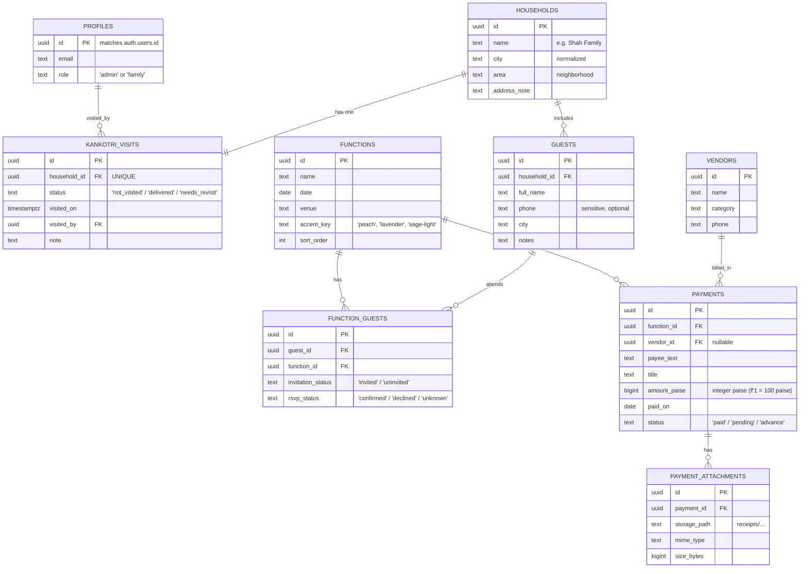

# Database Schema & Security Architecture

This document explains the database design, entity relationships, Row Level Security (RLS) policies, and verification steps for the **Wedding Command Center**.

---

## 1. Entity-Relationship Overview



---

## 2. Core Architectural Decisions (For CSE Interviews)

### Why decouple `households` and `guests`?
- **Real-world mapping:** In Indian wedding traditions, **invitation cards (Kankotris) are presented to families (households)**, not to each person separately. If an uncle's family has 4 members, you hand over 1 physical card.
- **Headcounts are personal:** Catering, hall seating, and bus/car seats are strictly per-individual.
- **Data normalization (3NF):** Storing household address details on a single household record prevents redundant address fields across 4 duplicate guest rows. If the family moves, we update one record.

### Why use `function_guests` as an associative (junction) table?
- In a multi-day Indian wedding, attendance varies by function (e.g. Sangeet might be intimate with 150 close relatives, whereas the Reception might host 400 guests).
- A guest exists **only once** in the `guests` table.
- A many-to-many relationship (`guests` $\leftrightarrow$ `functions`) is implemented through `function_guests`, which stores the guest's specific RSVP status for each individual event.

### Why integer `amount_paise` instead of `FLOAT` or `DECIMAL`?
- IEEE 754 floating-point representations introduce precision errors in arithmetic (e.g., `0.1 + 0.2 = 0.30000000000000004`).
- By converting all monetary values to the smallest currency unit (1 INR = 100 paise), we perform 100% exact integer math on the database server.
- ₹1,25,000.50 is stored as `12500050` paise.

---

## 3. Row Level Security (RLS) Line-by-Line Explanation

Row Level Security allows PostgreSQL to evaluate security conditions at the database engine level for **every single query**, regardless of whether the query comes from an API, a backend route, or the client.

### A. The Helper Function `is_admin()`
```sql
CREATE OR REPLACE FUNCTION public.is_admin()
RETURNS BOOLEAN
LANGUAGE sql
SECURITY DEFINER
STABLE
AS $$
  SELECT EXISTS (
    SELECT 1 FROM public.profiles
    WHERE id = auth.uid() AND role = 'admin'
  );
$$;
```
- `auth.uid()`: Supabase built-in function that extracts the user's UUID from the incoming JWT token.
- `SECURITY DEFINER`: The function runs with the privileges of the database owner rather than the calling user. **Why this matters:** When an RLS policy on table `guests` calls `is_admin()`, PostgreSQL doesn't get caught in an infinite recursion checking policies on `profiles`.
- `STABLE`: Tells the Postgres query planner that the output won't change within a single transaction, allowing query caching.

---

### B. Table Policies Explained

#### 1. `profiles` Table
```sql
CREATE POLICY "profiles_select_policy" ON public.profiles
  FOR SELECT TO authenticated
  USING (id = auth.uid() OR public.is_admin());
```
- **Line meaning:** Any authenticated family user can only view their own profile row (`id = auth.uid()`). An administrator can query all user profiles.

```sql
CREATE POLICY "profiles_update_policy" ON public.profiles
  FOR UPDATE TO authenticated
  USING (id = auth.uid() OR public.is_admin())
  WITH CHECK (
    public.is_admin() OR (id = auth.uid() AND role = (SELECT role FROM public.profiles WHERE id = auth.uid()))
  );
```
- **Line meaning:** Normal users can update their own email or profile details, but the `WITH CHECK` constraint ensures a non-admin cannot elevate their own role to `'admin'`.

#### 2. Operational Tables (`functions`, `households`, `guests`, `function_guests`, `kankotri_visits`, `vendors`, `payments`, `payment_attachments`)
```sql
CREATE POLICY "<table_name>_select" ON public.<table_name>
  FOR SELECT TO authenticated
  USING (true);
```
- **Line meaning:** Any signed-in family member with an authenticated session can read wedding details. Anonymous users (`anon`) have NO policies and are automatically rejected.

```sql
CREATE POLICY "<table_name>_insert" ON public.<table_name>
  FOR INSERT TO authenticated
  WITH CHECK (true);
```
- **Line meaning:** Any authenticated family member can mark a visit delivered, add a guest, or log an expense receipt.

```sql
CREATE POLICY "<table_name>_delete_admin" ON public.<table_name>
  FOR DELETE TO authenticated
  USING (public.is_admin());
```
- **Line meaning:** Destructive deletes are strictly reserved for admins. If a relative clicks delete accidentally, PostgreSQL aborts the operation.

---

## 4. Storage Bucket Security ("receipts")

1. **Private Bucket Flag (`public = false`):**
   - The bucket is marked private. No public URLs exist. If an unauthenticated person attempts to access `https://<project-ref>.supabase.co/storage/v1/object/public/receipts/bill.jpg`, Supabase returns HTTP 400/403.
2. **Access via Signed URLs:**
   - Photos are served via time-limited signed URLs generated on the server (e.g. valid for 60 seconds).
3. **Storage Policies:**
   - Authenticated users can upload and view receipts.
   - Only admins can permanently delete files from the bucket.

---

## 5. Manual Verification Checklist (Prove Logged-out Users Get Nothing)

To prove security before launching:

1. **Test in Supabase SQL Editor:**
   Run this simulation to test anonymous access:
   ```sql
   -- Switch to anonymous role
   SET ROLE anon;
   
   -- Attempt to read guests:
   SELECT * FROM public.guests;
   -- RESULT: Returns 0 rows. (Blocked!)
   
   -- Attempt to read payments:
   SELECT * FROM public.payments;
   -- RESULT: Returns 0 rows. (Blocked!)

   -- Attempt to read storage objects:
   SELECT * FROM storage.objects WHERE bucket_id = 'receipts';
   -- RESULT: Returns 0 rows. (Blocked!)
   
   -- Reset role back to admin/postgres:
   RESET ROLE;
   ```

2. **Test via REST API (cURL / Browser):**
   Make a `GET` request without an auth bearer token:
   ```bash
   curl "https://<your-supabase-url>/rest/v1/guests?select=*" \
     -H "apikey: <your-anon-key>"
   ```
   - **Expected response:** `[]` (empty list, 0 records returned).
